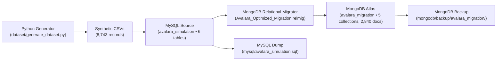

<div align="center">

# Avalara-Inspired MySQL to MongoDB Atlas Migration

**End-to-end relational-to-document database migration simulation using MySQL, MongoDB Atlas, and MongoDB Relational Migrator.**


[Overview](#1-project-overview) • [Architecture](#2-migration-architecture) • [Schema Design](#4-mongodb-target-design) • [Results](#6-migration-results) • [Quick Start](#9-running-the-python-dataset-generator) • [Reports & Docs](#10-documentation--reports)

</div>

---

## 1. Project Overview

This project demonstrates the migration of an Avalara-inspired relational tax-management database from **MySQL** to **MongoDB Atlas**.

The source database models a simplified tax management system containing **companies**, **customers**, **tax codes**, **items**, **transactions**, and **transaction lines**.

### Key Highlights
- **Relational Schema Design:** Normalized 6-table MySQL schema with foreign-key constraints and composite indexing.
- **Synthetic Dataset Pipeline:** Reproducible Python data generator & loader (`uv`, `pandas`, `mysql-connector-python`).
- **Document Schema Mapping:** Denormalization by embedding `transaction_lines` inside parent `transactions` documents.
- **Snapshot Migration & Verification:** Executed using **MongoDB Relational Migrator** (`Baseline` and `Optimized` `.relmig` configs included).
- **Full Reproducibility:** Includes MySQL SQL dumps and MongoDB `mongodump` BSON backups.

> [!NOTE]
> This is an academic reconstruction inspired by publicly documented Avalara AvaTax concepts. It uses synthetic data and does not represent Avalara's proprietary internal database schema or production data.

---

## 2. Migration Architecture



### Technology Stack

| Technology | Purpose |
|---|---|
| **MySQL 9.7.2** | Source relational database |
| **MongoDB Atlas** | Target cloud document database |
| **MongoDB Relational Migrator** | Schema mapping, snapshot migration & verification |
| **MongoDB Database Tools** | `mongodump` / `mongorestore` backup and restoration |
| **MySQL Workbench** | Database management and SQL export |
| **MongoDB Compass** | Document inspection and query verification |
| **Python 3.14.6** | Synthetic dataset generation and MySQL loading |
| **uv** | Fast Python dependency management |

---

## 3. Source Database: MySQL

The source database (`avalara_simulation`) contains **6 relational tables** totaling **8,743 synthetic records**:

| Table | Records | Description |
|---|---:|---|
| `companies` | 10 | Company information |
| `customers` | 500 | Customer records |
| `tax_codes` | 30 | Tax classification codes |
| `items` | 300 | Products and services |
| `transactions` | 2,000 | Transaction headers |
| `transaction_lines` | 5,903 | Individual transaction line items |
| **Total** | **8,743** | |

The `transaction_lines` table references its parent transaction using a composite relationship involving `company_id` and `transaction_id`.

---

## 4. MongoDB Target Design

The target database in MongoDB Atlas (`avalara_migration`) consolidates the 6 relational tables into **5 top-level collections**:

| MongoDB Collection | Source Table(s) |
|---|---|
| `companies` | `companies` |
| `customers` | `customers` |
| `items` | `items` |
| `taxCodes` | `tax_codes` |
| `transactions` | `transactions` + `transaction_lines` *(embedded)* |

### Embedded Document Mapping

Instead of keeping `transaction_lines` in a separate collection, the optimized mapping embeds line items directly inside their parent `transaction` document so a transaction and all its lines can be fetched in a single read:

```javascript
{
  _id: ObjectId("..."),
  transactionId: 1001,
  companyId: 1,
  customerId: 25,
  status: "Committed",
  totalAmount: 2500.00,
  totalTax: 300.00,
  lines: [
    {
      lineId: 1,
      lineNumber: 1,
      itemId: 101,
      quantity: 2,
      unitPrice: 1100.00,
      lineAmount: 2200.00,
      taxCodeSnapshot: "TAX001",
      taxRate: 0.13636,
      taxAmount: 300.00,
      jurisdictionCode: "US-CA"
    }
  ]
}
```

---

## 5. Migration Process

1. **Source Database Preparation:** Created MySQL schema & indexes, generated synthetic CSVs, and loaded data into `avalara_simulation`.
2. **Relational Mapping:** Connected MySQL and MongoDB Atlas in Relational Migrator, embedded `transaction_lines` inside `transactions`, and removed the standalone `transactionLines` mapping.
3. **Migration Configuration:**
   - **Mode:** Snapshot (`avalara_simulation` → `avalara_migration`)
   - **Collections:** 5 target collections
   - **Data Verification:** Enabled (`Drop destination collections: Disabled`)
4. **Migration Execution:** Snapshot migration processed all six source tables and completed successfully.

---

## 6. Migration Results

| Collection | Documents |
|---|---:|
| `companies` | 10 |
| `customers` | 500 |
| `items` | 300 |
| `taxCodes` | 30 |
| `transactions` | 2,000 *(with 5,903 embedded line items)* |
| **Total top-level documents** | **2,840** |

### Migration Verification
- Snapshot processing completed for all six source tables.
- Five target collections verified with no inconsistencies found.
- Generated MongoDB `_id` fields were skipped during comparison since they have no relational counterpart.

> [!IMPORTANT]
> The migration review summary reported 8,565 rows to migrate while the MySQL source contained 8,743 records (a difference of 178). The verification result applies to the collections and source tables reported by Relational Migrator and should not be interpreted as independent proof that every source row was migrated.

---

## 7. Database Backup and Restoration

### MySQL Backup
Restore the MySQL source database from `mysql/avalara_simulation.sql`:

```bash
mysql -u root -p < mysql/avalara_simulation.sql
```

### MongoDB Backup
Restore the MongoDB Atlas backup from `mongodb/backup/avalara_migration/` using MongoDB Database Tools:

```bash
mongorestore \
  --uri="YOUR_MONGODB_CONNECTION_STRING" \
  --nsInclude="avalara_migration.*" \
  mongodb/backup
```

---

## 8. Repository Structure

```text
avalara_mysql_mongodb_migration_simulation/
├── dataset/
│   ├── generate_dataset.py          # Synthetic dataset generator
│   ├── load_dataset.py              # MySQL data loader
│   ├── generated/                   # Generated CSVs & manifest
│   ├── mongodb/backup/              # MongoDB BSON backup
│   └── mysql/                       # MySQL schema, indexes & dump
├── docs/
│   ├── Project_Report_NIT_Delhi_LaTeX_Style (1).pdf
│   ├── Project_Report_NIT_Delhi_LaTeX_Style (1).docx
│   ├── Project_Synopsis_NIT_Delhi.pdf
│   ├── Project_Synopsis_NIT_Delhi.docx
│   └── screenshot/                  # Migration & verification screenshots
├── migration/
│   ├── Avalara_Baseline_Migration.relmig
│   └── Avalara_Optimized_Migration.relmig
├── mongodb/backup/avalara_migration/
├── mysql/
│   ├── schema.sql
│   ├── indexes.sql
│   └── avalara_simulation.sql
├── test_atlas.py                    # MongoDB Atlas connection test
├── pyproject.toml
├── requirements.txt
├── uv.lock
├── .python-version
├── .env.example
└── .gitignore
```

---

## 9. Running the Python Dataset Generator

1. **Install `uv`** (if not already installed):
   ```bash
   pip install uv
   ```
2. **Install dependencies:**
   ```bash
   uv sync
   ```
3. **Configure environment variables:** Copy `.env.example` to `.env` and fill in your local MySQL / MongoDB credentials *(never commit `.env`)*.
4. **Generate the synthetic dataset:**
   ```bash
   uv run python dataset/generate_dataset.py
   ```
5. **Load data into MySQL:**
   ```bash
   uv run python dataset/load_dataset.py
   ```

---

## 10. Documentation & Reports

- **Project Synopsis:** [Project_Synopsis_NIT_Delhi.pdf](docs/Project_Synopsis_NIT_Delhi.pdf) ([DOCX](docs/Project_Synopsis_NIT_Delhi.docx))
- **Project Report:** [Project_Report_NIT_Delhi_LaTeX_Style (1).pdf](docs/Project_Report_NIT_Delhi_LaTeX_Style%20(1).pdf) ([DOCX](docs/Project_Report_NIT_Delhi_LaTeX_Style%20(1).docx))

<details>
<summary><b>📸 View Migration & Verification Screenshots</b></summary>

<br/>

| | |
|---|---|
|  |  |
|  |  |
|  |  |
|  |  |

</details>

---

<div align="center">

**Author:** Satvik Nagar • **Project Type:** Academic Database Migration Demonstration (NIT Delhi)  
**Source:** MySQL (`avalara_simulation`) • **Target:** MongoDB Atlas (`avalara_migration`) • **Tool:** MongoDB Relational Migrator

</div>
